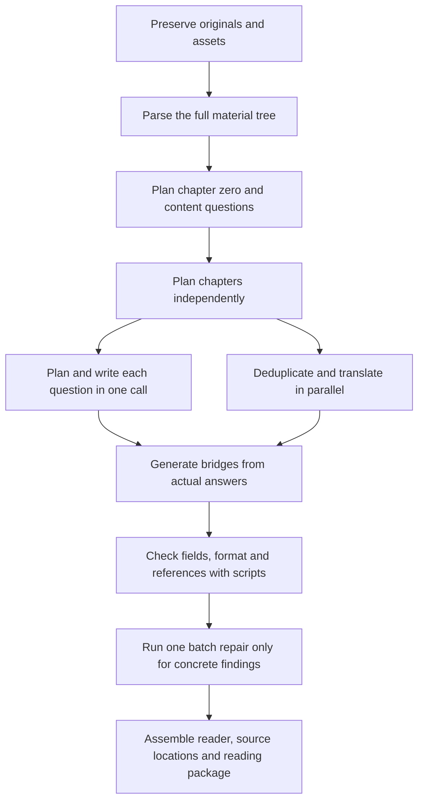

<div align="center">
<h1 align="center">LessonWeave</h1>
<p><strong>Turn webpages, PDFs and repositories into source-grounded Chinese learning books</strong></p>
<p>Personal self-hosting · Lightweight C workflow · AGPL-3.0</p>
<p><a href="README.md">简体中文</a> · <a href="#2-how-to-start">Quick start</a> · <a href="framework/05_writing/lean-flow.md">Core workflow</a> · <a href="docs/deployment.md">VPS deployment</a></p>
</div>

<div align="center">

<p><sub>Figure 1.1　The reading workbench uses self-authored demonstration material</sub></p>
</div>

## 1 What the workflow does

Submit a webpage, PDF or project ZIP. LessonWeave preserves the originals, builds a material tree, plans questions and chapters, then writes explanations, independent media guides, exercises and terminology. Readers can return to original sentences, pages or source-code ranges and keep their notes

The C workflow plans multiple explanation items and writes multiple explanation groups within the same call for each question. Scripts then check fields, format and source references. Concrete findings trigger one batch repair round; AI semantic quality review stays disabled

## 2 How to start

Prepare Python 3.11+, Node.js 20+ and a usable Codex CLI login. Web archival also needs Docker. English-to-Chinese translation reads the official DeepSeek key from AIALRA_DEEPSEEK_OFFICIAL_KEY

```bash
# Download the source and run the cross-platform installer
 git clone https://github.com/AIALRA-0/AIALRA-LessonWeave.git
 cd AIALRA-LessonWeave
 python deploy/bootstrap.py
```

Windows, Linux and macOS use this Python entry point. It creates an isolated environment, installs the PDF parser and browser, then starts http://127.0.0.1:8960/workspace. Use codex login for first-time authentication. Data defaults to .lessonweave under the user's home directory

On an Ubuntu or Debian VPS, run this inside the checkout

```bash
# Install the system service, then configure the authenticated reverse proxy
sudo bash deploy/install-vps.sh
```

Generation consumes the execution account's model allowance. Keep credentials outside source control. Login, translation credentials, owner and domain configuration are described in the [deployment guide](docs/deployment.md)

## 3 How generation progresses

<div align="center">



<p><sub>Figure 3.1　Writing and translation run concurrently, terminology is generated with writing, and scripts assemble the reader</sub></p>
</div>

A vertical stage list and its detail panel show completed units, active calls, waiting work, elapsed time and saved records on one page. Refreshing or reopening the page reads the same persistent background job

Defaults are Sol high for planning and writing with 144 writing slots; Flash without reasoning with 12 translation slots; bridges in batches of 16 sections with 7 slots; repair with 3 slots. Existing senses reuse the full definition, everyday analogy and short generic example; special senses remain separate. See the [C workflow](framework/05_writing/lean-flow.md)

## 4 Where the core harness lives

- lessonweave/planning.py schedules question and independent chapter planning, includes chapter zero in the first pass, and supplements only actual missing assignments
- lessonweave/lean.py schedules writing, translation, bridges and assembly
- framework/00_source through framework/05_writing contain parsers, schemas, prompts and checks
- framework/reader and web contain the reader, progress display and system information
- deploy contains local and VPS installation entry points; tests contains regression checks that do not consume model allowance

Private materials, model logs, credentials, notes, experimental archives and machine configuration are excluded from the public repository

## 5 How to verify and maintain

```bash
# Install test dependencies and verify core behavior
python -m pip install -e '.[test]'
python -m pytest
```

Coverage counts actual material dispositions and explanation source references. Source locations separately record exact, ambiguous and unavailable results. PDF equations retain original images, and third-party video offline playback can still have gaps

Export a reading package or connect through the [ReadWeave adapter](integrations/readweave/HANDOFF.md) to Trilium. Back up persistent data and the database before deployment

Use self-authored reproductions in this repository's Issues and remove private text and model logs. See [SECURITY.md](SECURITY.md), [LICENSE](LICENSE) and [NOTICE](NOTICE)

