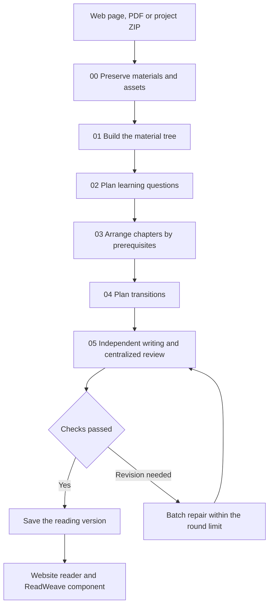

<div align="center">
<h1>LessonWeave</h1>
<p><strong>Turn web pages, papers and code into progressive learning books that stay connected to their sources</strong></p>
<p>0.1.0 preview · Personal self-hosting · Native Codex CLI · AGPL-3.0</p>
<p><a href="README.md">简体中文</a> · <a href="#2-get-started">Get started</a> · <a href="docs/architecture.md">Architecture</a> · <a href="integrations/readweave/HANDOFF.md">ReadWeave integration</a> · <a href="docs/deployment.md">Deployment</a></p>
</div>

<div align="center">

<p><sub>Figure 1.1　Brand illustration showing different materials entering one learning workflow</sub></p>
</div>

## 1 Follow the material toward understanding

Provide a web page, PDF or project ZIP, LessonWeave preserves the material and local resources, builds a question tree and chapters, then writes each learning unit with direct links to the original sentences, figures and code

Writing and review use independent Sol contexts, each information point links to actual explanation blocks, coverage is recalculated by code, and unsuccessful versions retain their real review status and complete previews

<div align="center">

<p><sub>Figure 1.2　The running workspace brings folders, source pages, translations, explanations and terms together</sub></p>
</div>

<div align="center">
<p>Table 1.1　Ways to continue understanding while reading</p>

| Task | Support |
|---|---|
| Follow a learning sequence | Questions are assigned exactly once to chapters |
| Compare with the source | Original pages, translations, figures and code ranges stay beside explanations |
| Look up a term | Hovering a registered term opens its glossary entry |
| Trace an explanation | Source markers locate original sentences, regions or lines |
| Reflect and practice | One note field per complete unit, with exercises and feedback |
| Manage learning projects | Choose a folder, rename or move projects, and restore items from trash |
| Control generation | Follow actual stage progress, stop processes and resume completed work |
| Read in ReadWeave | Store native Trilium notes and attachments, and compare sources through renderNote |

</div>

The views use actual generated data, source code and runtime materials are stored separately, the public repository contains implementation and self-authored examples

## 2 Get started

Use Python 3.11 or newer and a signed-in Codex CLI with access to the selected model

- First, create an isolated environment and install dependencies from the repository root

```bash
# Linux or macOS: install project-local dependencies
python3 -m venv .venv
.venv/bin/python -m pip install -r requirements.txt
.venv/bin/python -m playwright install chromium
```

```powershell
# Windows: use the project's Python environment
python -m venv .venv
.venv\Scripts\python.exe -m pip install -r requirements.txt
.venv\Scripts\python.exe -m playwright install chromium
```

- Next, sign in with the official CLI, the default model is `gpt-6.1-sol` with `high` reasoning

```bash
# The official CLI keeps login credentials outside this repository
codex login
```

- Finally, start the workspace with the Python environment containing the dependencies

```bash
# Run from the activated project environment
.venv/bin/python -m lessonweave serve --port 8960
```

On Windows, start with `.venv\Scripts\python.exe -m lessonweave serve --port 8960`

Open `http://localhost:8960/workspace`, choose or create a folder, select Generate Book, then submit a web page, PDF or project ZIP, task cards show actual progress and processing continues after closing the page

The tree supports search, folding, renaming, moving, trash and restoration, stopping a task terminates its model and parsing processes while keeping completed stages, usage receipts and notes

Production deployments require personal authentication and an owner restriction, model calls consume your Codex allowance, see [deployment](docs/deployment.md) for permissions and backups

## 3 Follow one complete generation

<div align="center">



<p><sub>Figure 3.1　Scripts schedule the stages, agents handle semantic work, revisions target affected units after centralized checks</sub></p>
</div>

Drafting is round 0, repairs default to three rounds and are capped at four, durable task identifiers prevent duplicate submissions and completed requests with identical inputs are reused

See [usage](docs/usage.md) for direct input-file execution and [04-framework](04-framework) for stage implementations and contracts

## 4 Hand results to ReadWeave

<div align="center">

<p><sub>Figure 4.1　The reader runs in a real Trilium host, chapters and resources use native notes and attachments</sub></p>
</div>

The Trilium adapter uses ETAPI for projects, chapters and version attachments, renderNote mounts the reader, personal notes use authenticated host APIs, native text chapters reuse ReadWeave's existing question-answer interface

Mounting, attachments, native chapters and note round trips were verified in an isolated TriliumNext 0.104.0 ReadWeave instance, the production maintainer owns deployment, see the [handoff guide](integrations/readweave/HANDOFF.md) for configuration and verification boundaries

## 5 Validate results and protect data

- `python -m pytest` checks input validation, deduplication, recovery, notes, independent requests, repair limits and package import
- `tests/check_pages.py` checks the running workspace and readers in an isolated browser and saves screenshots
- `tests/check_workspace.py` exercises folder operations, themes, narrow screens and character-level source highlighting through actual APIs without model calls
- Stage checks, independent reviews, source snapshots and usage receipts remain in each project's runtime directory
- Debug is off during normal reading, preview versions retain their actual status and stage inspection exposes detailed records

Code is public, accounts, original materials, model logs and personal notes remain private, keep API keys and CLI login directories outside the repository, see [SECURITY.md](SECURITY.md) for reporting

## 6 Contribute and check the license

Use repository Issues for problems and suggestions, reproduce with self-authored materials and remove credentials, private sources and raw call logs

Licensed under [GNU AGPL v3](LICENSE), dependencies and provenance are listed in [NOTICE](NOTICE), this repository owns the shared reader and generation framework, the ReadWeave maintainer owns its deployment and application changes
