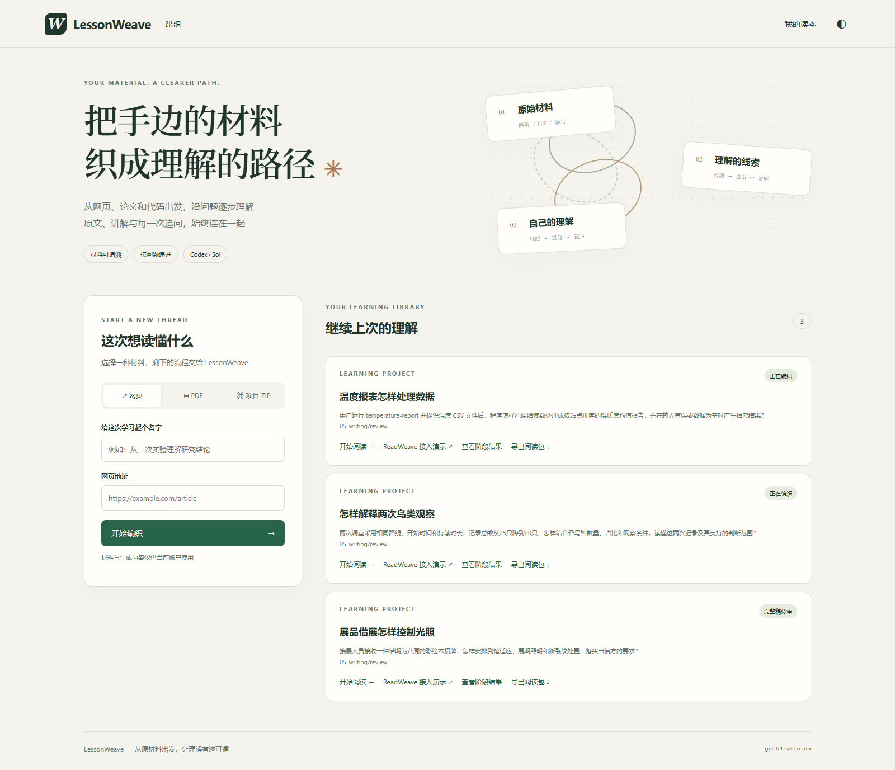
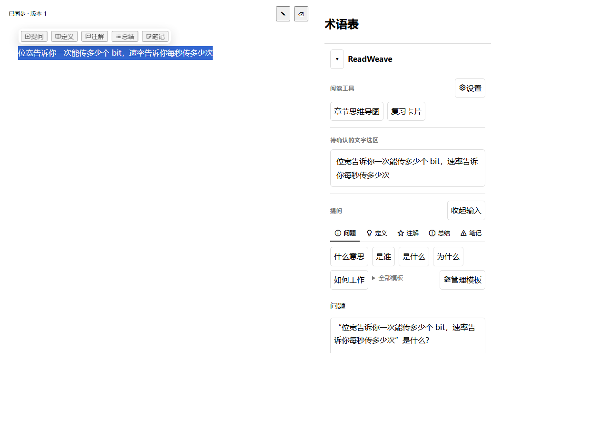
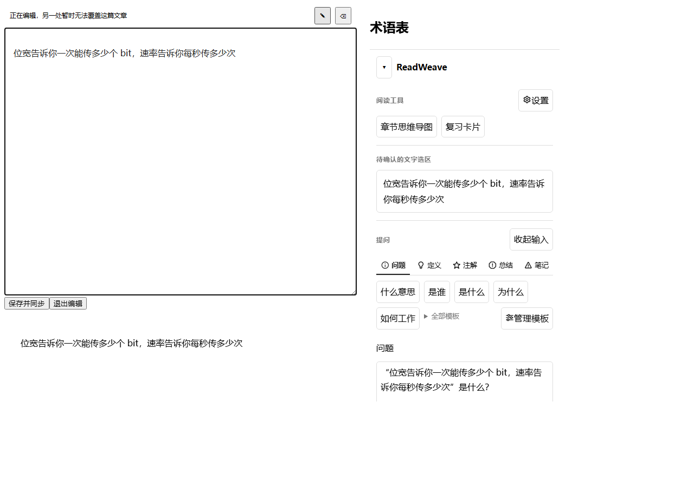
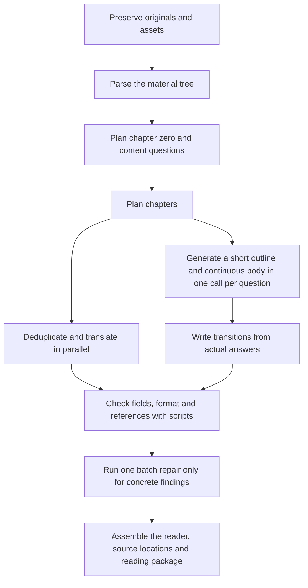

<div align="center">
<h1>LessonWeave</h1>
<p align="center"><strong>Turn webpages, PDFs and source repositories into Chinese learning books linked back to their sources</strong></p>
<p align="center">v0.2.0 · Personal self-hosting · AGPL-3.0</p>
<p align="center"><a href="README.md">简体中文</a> · <a href="#2-start-locally">Start locally</a> · <a href="docs/architecture.md">13-stage architecture</a> · <a href="docs/deployment.md">VPS deployment</a> · <a href="docs/examples.md">Public case bundle (Chinese)</a></p>
</div>

<div align="center">

<p><sub>Figure 1.1　The workbench keeps source locations, continuous explanations and terminology on one page, using self-authored example material</sub></p>
</div>

<table>
<tr>
<td></td>
<td></td>
</tr>
<tr>
<td><sub>Figure 1.2　After selecting text, readers can ask, define, annotate, summarize or take a note, and open terminology or chapter tools</sub></td>
<td><sub>Figure 1.3　Shared editing warns that another location cannot overwrite the article temporarily; readers can save and sync or leave edit mode</sub></td>
</tr>
</table>

## 1 How LessonWeave helps readers study source material

Submit a webpage, PDF or project ZIP. LessonWeave preserves the original, parses its structure, plans learning questions and chapters, then writes a continuous explanation for each question. Readers can return from the text to a webpage passage, PDF page or source-code range, and can view translations, media guides, exercises, terminology and personal notes.

Writing uses `continuous-unit-2.0`: each question gets one writing call that first creates a short outline and then writes a continuous body along that outline. Media, answers, exercises, pitfalls and terminology are included in the same call. Deduplicated English-to-Chinese translation runs alongside writing; after the answers are ready, the system writes transitions from the actual results.

## 2 Start locally

Prepare Python 3.11 or later. If Codex CLI is not installed, also prepare Node.js 20 or later; the installer can add the official CLI and start device login when needed. Web archiving needs Docker running. For English-to-Chinese translation, set the DeepSeek official key in `AIALRA_DEEPSEEK_OFFICIAL_KEY`.

Run the installer from a terminal:

```bash
# Download the repository and install its dependencies
git clone https://github.com/AIALRA-0/AIALRA-LessonWeave.git
cd AIALRA-LessonWeave
python deploy/bootstrap.py
```

The installer opens `http://127.0.0.1:8960/workspace` in your browser. After the first submission, the workbench shows each stage's progress. Writing and translation use the configured model allowance. Original material, call records and notes default to `.lessonweave` under the user's home directory; set `LESSONWEAVE_DATA` to choose another persistent directory.

The [usage guide](docs/usage.md) shows how to submit the repository's self-authored webpage, PDF and code examples. The [deployment guide](docs/deployment.md) covers local and VPS installation.

## 3 How thirteen stages turn material into a book

The diagram summarizes the order of work. After question planning, chapter planning, per-question writing and translation follow separate work paths. Writing and translation run in parallel; transitions wait for the actual answers. The [architecture guide](docs/architecture.md) describes every numbered stage, its artifacts and its checks.

<div align="center">



<p><sub>Figure 3.1　Each question uses one writing call, terminology is generated with the body, and scripts check and assemble the result</sub></p>
</div>

Question planning records material purpose separately from the specific questions responsible for teaching it. The workbench displays all 13 stages, elapsed time, model calls, repair calls and available coverage records; missing data appears as “not recorded.”

When ReadWeave is configured, the 13th stage (internal workflow ID 12) first syncs the reading package, material tree, chapters and attachments, then registers explanations, originals, translations and term definitions. These steps run in sequence under one stage status, while their mapping files store their actual results separately.

Defaults allow up to 144 concurrent Sol high writing calls and 12 Flash translation batches of about 24,000 UTF-8 bytes each. After writing, transition generation runs in up to 7 concurrent batches of 16 sections; a batch repair can run up to 3 calls at once. Environment variables and project settings can override these values.

## 4 What each coverage value describes

LessonWeave reports separately whether material is preserved, whether each item has a clear destination, whether teachable content is assigned to a specific question, and whether the body references its assigned source. Chapter assignment is checked separately, and each question must appear exactly once in the outline.

Source mapping helps readers find the material behind an explanation, but it does not replace reading the facts, conditions and reasoning. The current workflow does not run an AI semantic quality score. It runs one batch repair only when scripts find concrete field or reference issues, and skips the repair model when no issue is found.

## 5 Where to find more

- [Architecture guide](docs/architecture.md) explains the 13 stages, coverage records and per-question writing
- [Architecture page guide](docs/architecture-view.md) explains how the workbench displays fields, diagrams and runtime state
- [Usage guide](docs/usage.md) covers first use, recovery, export and data storage
- [Deployment guide](docs/deployment.md) covers local and VPS deployment, authenticated reverse proxies, upgrades and backups
- [Public case bundle guide in Chinese](docs/examples.md) describes the offline reading examples, their sources and exclusions
- [ReadWeave validation results](docs/readweave-validation.md) lists the backend, HTTP, BFF, UI and bounded-state checks that have passed so far
- [Agent deployment prompt](docs/agent-deployment.md) provides a basic prompt to adapt for a server deployment
- [ReadWeave handoff](integrations/readweave/HANDOFF.md) lists the adapter's current scope and reviewable records
- [v0.2.0 Release (ReadWeave source and public cases)](https://github.com/AIALRA-0/AIALRA-LessonWeave/releases/tag/v0.2.0) provides the source and public case bundles
- [Security policy](SECURITY.md), [license](LICENSE) and [third-party notices](NOTICE) describe security contact and usage terms

Keep source material, model requests and receipts, accounts, personal notes and machine configuration in the local data directory or outside the repository. Use self-authored material when reporting an issue, and remove private source text and call logs first.
