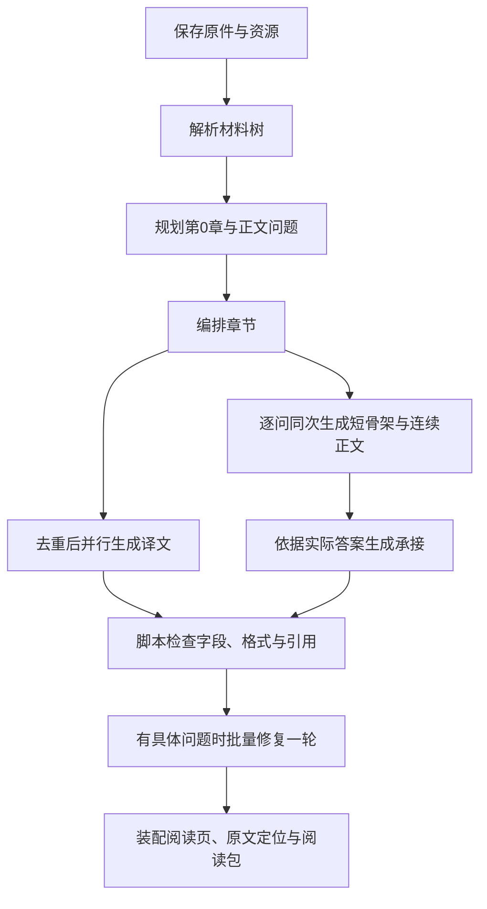

<div align="center">
<h1>LessonWeave · 课织</h1>
<p align="center"><strong>把网页、PDF 和项目源码整理成能回到原文查证的中文学习读本</strong></p>
<p align="center">v0.2.0 · 个人自托管 · AGPL-3.0</p>
<p align="center"><a href="README.en.md">English</a> · <a href="#2-怎样在本地启动">本地启动</a> · <a href="docs/architecture.md">13 阶段架构</a> · <a href="docs/deployment.md">VPS 部署</a> · <a href="docs/examples.md">公开案例包</a></p>
</div>

<div align="center">

<p><sub>图 1.1　工作台把原文位置、连续讲解和术语放在同一页，截图使用自编演示材料</sub></p>
</div>

<table>
<tr>
<td></td>
<td></td>
</tr>
<tr>
<td><sub>图 1.2　选中文本后，读者可以提问、定义、注解、总结或记笔记，也可以查看术语与章节工具</sub></td>
<td><sub>图 1.3　共享编辑会提示另一处暂时无法覆盖正文，读者可保存并同步修改或退出编辑</sub></td>
</tr>
</table>

## 1 LessonWeave 怎样帮助读者学习材料

提交网页、PDF 或项目 ZIP 后，LessonWeave 会保存原件、解析材料结构、规划学习问题和章节，再逐问生成连续讲解；读者可以从正文回到网页段落、PDF 页面或源码位置，也可以查看译文、媒体说明、练习、术语和自己的笔记

正文使用 `continuous-unit-2.0`；每个问题只调用一次写作模型，模型先生成短骨架，再沿骨架写连续正文；同次调用还会生成媒体说明、答案、练习和易错点，并生成术语及完整解释；英译中会先去重，再与正文并行处理；全部正文完成后，系统根据实际答案生成承上启下内容

## 2 怎样在本地启动

准备 Python 3.11 或更新版本；若本机没有 Codex CLI，再准备 Node.js 20 或更新版本，安装器会按需安装官方 CLI 并启动设备登录；网页归档需要 Docker 正在运行；需要英译中时，把 DeepSeek 官方密钥放进环境变量 `AIALRA_DEEPSEEK_OFFICIAL_KEY`

在终端运行安装器：

```bash
# 下载仓库并安装依赖
git clone https://github.com/AIALRA-0/AIALRA-LessonWeave.git
cd AIALRA-LessonWeave
python deploy/bootstrap.py
```

安装器会在浏览器中打开 `http://127.0.0.1:8960/workspace`；第一次提交后，工作台会显示各阶段进度，生成和翻译会使用你配置的模型额度；项目原件、调用记录和笔记默认保存在用户目录下的 `.lessonweave`，也可以用 `LESSONWEAVE_DATA` 指定持久目录

第一次使用可以从[使用指南](docs/usage.md)提交仓库内自编的网页、PDF 或代码示例；完整的本地与 VPS 安装步骤见[部署指南](docs/deployment.md)

## 3 十三个阶段怎样把材料变成读本

下图概括各阶段的先后关系；问题规划后，章节编排、逐问正文和译文由不同工作安排；正文与译文并行生成，承接等实际答案完成后再写，每个编号阶段的输入、产物和检查记录见[架构说明](docs/architecture.md)

<div align="center">



<p><sub>图 3.1　每问正文只调用一次写作模型，术语随正文生成，脚本负责检查和装配</sub></p>
</div>

问题规划会分别记录材料用途和应讲内容的具体问题归属；系统会在工作台显示 13 阶段状态、用时、模型调用数、修复调用数和可用的覆盖记录，缺少的数据会显示“未记录”

配置 ReadWeave 后，第 13 阶段（流程内部编号 12）会先同步阅读包、材料树、章节和附件，再登记正文、原文、译文与术语定义；这两个动作顺序执行、共用一个阶段状态，两个映射文件分别保存实际结果

默认最多同时进行 144 个 Sol high 写作调用和 12 个 Flash 翻译批次，每批翻译约 24,000 个 UTF-8 字节；正文完成后，承接最多并发 7 批、每批 16 节；需要批量修复时最多并发 3 个修复调用；环境变量和项目设置可以覆盖这些默认值

## 4 覆盖数字分别说明什么

LessonWeave 把材料是否保存、每项材料是否有明确去向、应讲内容是否分配给具体问题，以及正文是否引用负责的材料分开计算；问题章节归属也会单独核对，脚本要求每个问题在目录中恰好出现一次

正文来源映射可以帮助读者找到对应材料，但它不替代对事实、条件和推导的阅读判断；当前流程不调用 AI 对正文做语义质量评分，发现具体字段或引用问题时才会执行一轮批量修复，检查没有发现问题时会跳过修复模型

## 5 从哪里了解更多

- [架构说明](docs/architecture.md)解释 13 个阶段、覆盖数字和每问正文怎样生成
- [架构页说明](docs/architecture-view.md)介绍工作台怎样展示真实字段、流程图和运行状态
- [使用指南](docs/usage.md)说明网站与命令行的第一次运行、恢复、导出和数据保存
- [部署指南](docs/deployment.md)说明本地部署、VPS 服务、认证反向代理、升级与备份
- [公开案例包说明](docs/examples.md)介绍离线阅读案例、来源和排除范围
- [ReadWeave 验证结果](docs/readweave-validation.md)汇总当前通过的后端、HTTP、BFF、界面和有界状态检查
- [Agent 部署提示词](docs/agent-deployment.md)提供一份可按服务器情况填写的基础部署任务说明
- [ReadWeave 交接说明](integrations/readweave/HANDOFF.md)列出适配器的当前范围和可复核记录
- [v0.2.0 Release（ReadWeave 源码与公开案例）](https://github.com/AIALRA-0/AIALRA-LessonWeave/releases/tag/v0.2.0)提供源码包和公开案例包
- [安全报告](SECURITY.md)、[许可证](LICENSE)和[第三方署名](NOTICE)说明安全联系渠道和使用边界

运行材料、模型请求与回执、账号、个人笔记和机器配置应保存在本地数据目录或仓库外的配置中；提交问题时请使用自编材料，并先移除私人原文与调用日志
