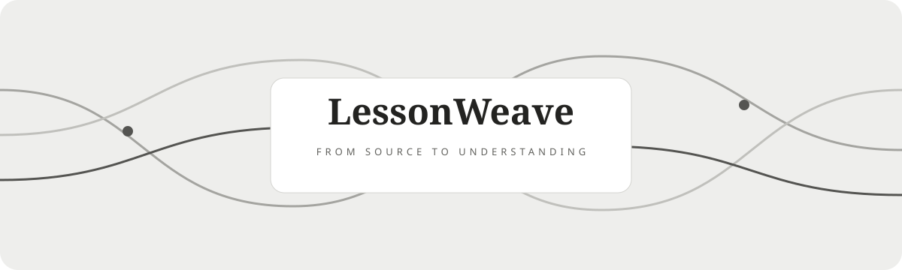
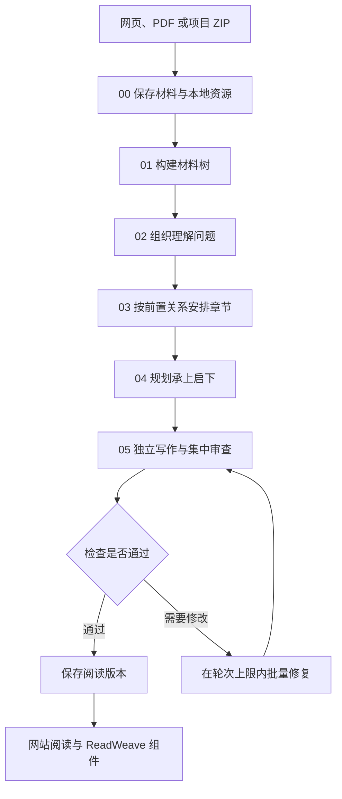

<div align="center">
<h1>LessonWeave · 课织</h1>
<p><strong>把网页、论文与代码，织成循序渐进、可以回到原材料的学习读本</strong></p>
<p>0.1.0 预览版 · 个人自托管 · Codex CLI 原生调用 · AGPL-3.0</p>
<p><a href="README.en.md">English</a> · <a href="#2-怎样开始使用">开始使用</a> · <a href="docs/architecture.md">工作原理</a> · <a href="integrations/readweave/HANDOFF.md">ReadWeave 接入</a> · <a href="docs/deployment.md">部署指南</a></p>
</div>

<div align="center">

<p><sub>图 1.1　品牌示意图，三条线索表示不同材料进入同一套学习流程</sub></p>
</div>

## 1 从一份材料，走到自己的理解

LessonWeave 适合希望围绕原材料深入学习的人，你提供一个网页、一份 PDF 或一个项目 ZIP，程序获取并保存材料，再组织问题、章节和逐问讲解，阅读时可以随时对照原句、图表和源码

写作与审查分别使用独立的 Sol 上下文，每个信息点关联实际正文位置，覆盖结果由程序重新计算，未通过的版本保留真实检查状态和完整预览

<div align="center">

<p><sub>图 1.2　实际工作台，目录、原页与译文、讲解和术语共同服务当前学习项目</sub></p>
</div>

<div align="center">
<p>表 1.1　阅读时可以怎样沿着材料继续理解</p>

| 需要做什么 | LessonWeave 怎样支持 |
|---|---|
| 按理解顺序学习 | 从问题树组织章节，每个问题恰好归入一个位置 |
| 对照材料 | 在讲解旁查看原页、译文、图表与源码范围 |
| 查术语 | 指向正文术语时，右栏展开对应解释 |
| 回到来源 | 从讲解块定位到相关原句、页面区域或代码行 |
| 消化所学 | 每个完整讲解单元保留一个笔记框，并提供练习反馈 |
| 管理学习项目 | 在可折叠目录树中选择生成位置，重命名、移动和恢复项目 |
| 控制生成任务 | 查看真实阶段进度，停止进程，保留已完成结果并继续 |
| 在 ReadWeave 阅读 | 保存为 Trilium 原生笔记与附件，在 renderNote 中对照阅读 |

</div>

这些能力共用实际生成的数据，源码和运行材料分别保存，公开仓库只包含实现与自编示例

## 2 怎样开始使用

准备 Python 3.11 或更新版本，以及已经登录、能够使用所选模型的 Codex CLI

- 第一步，在仓库根目录创建环境并安装依赖

```bash
# Linux 或 macOS：为本项目安装独立依赖
python3 -m venv .venv
.venv/bin/python -m pip install -r requirements.txt
.venv/bin/python -m playwright install chromium
```

```powershell
# Windows：使用本项目自己的 Python 环境
python -m venv .venv
.venv\Scripts\python.exe -m pip install -r requirements.txt
.venv\Scripts\python.exe -m playwright install chromium
```

- 第二步，完成本机 Codex 登录，默认模型为 `gpt-6.1-sol`，推理档位为 `high`

```bash
# 登录由官方 CLI 处理，凭据保存在代码仓库之外
codex login
```

- 第三步，启动网站，下面命令使用已安装依赖的 Python 环境

```bash
# 在已激活的项目环境中启动个人工作台
.venv/bin/python -m lessonweave serve --port 8960
```

Windows 使用 `.venv\Scripts\python.exe -m lessonweave serve --port 8960` 启动

打开 `http://localhost:8960/workspace`，选择或新建文件夹，点击“生成读本”，选择网页、PDF 或项目 ZIP 并提交，任务卡显示实际进度，关闭页面后后台继续处理

目录支持搜索、折叠、重命名、移动、回收站与恢复，停止任务时会结束模型和解析子进程，已完成的阶段、调用回执和笔记继续保留

生产部署需要配置个人登录和所有者限制，模型调用会使用你的 Codex 额度，安装、备份和权限配置见[部署指南](docs/deployment.md)

## 3 一次生成怎样走完整个流程

<div align="center">



<p><sub>图 3.1　脚本调度固定步骤，agent 处理语义任务，集中检查后按受影响单元批量修改</sub></p>
</div>

初稿记为第 0 轮，默认最多进行三轮修复，配置上限为四轮，重复提交使用稳定任务标识去重，相同输入的已完成模型请求复用结果

直接运行输入文件的方法见[使用说明](docs/usage.md)，各步骤的实现与检查合同保存在 [04-framework](04-framework)

## 4 怎样交给 ReadWeave

<div align="center">

<p><sub>图 4.1　真实 Trilium 宿主中的阅读组件，章节与资源保存在原生笔记和附件中</sub></p>
</div>

Trilium 适配器通过 ETAPI 保存项目、章节和版本附件，renderNote 加载四栏阅读组件，学习笔记通过宿主前端接口保存，原生 text 章节沿用 ReadWeave 已有问答器

已在独立的 TriliumNext 0.104.0 ReadWeave 实例验证挂载、附件、章节与笔记往返，正式 ReadWeave 服务由其维护者接入，配置和验收范围见[组件交接说明](integrations/readweave/HANDOFF.md)

## 5 怎样检查结果与保护资料

- `python -m pytest` 检查输入、任务去重、恢复、笔记、独立请求、修复上限和阅读包导入
- `tests/check_pages.py` 在隔离浏览器中检查工作台与阅读界面，并保存实际截图
- `tests/check_workspace.py` 检查目录操作、主题、窄屏与源码字符高亮，使用实际接口且不调用模型
- 阶段检查记录、独立审查、来源快照和实际用量保存在各项目的运行目录
- 普通阅读默认关闭 Debug，未通过的版本显示实际状态，详细检查可以从阶段预览进入

源码公开，账号、原材料、模型日志和个人笔记由部署者私有保存，密钥与 CLI 登录目录保持在仓库之外，安全报告方式见 [SECURITY.md](SECURITY.md)

## 6 怎样贡献和确认许可

问题与改进建议可以通过本仓库的 Issues 提交，请使用自编材料复现，并移除账号、密钥、私人原文和调用日志

项目使用 [GNU AGPL v3](LICENSE)，依赖与来源说明见 [NOTICE](NOTICE)，公共阅读组件与生成框架在本仓库维护，正式 ReadWeave 的部署和业务修改由其项目维护者负责
