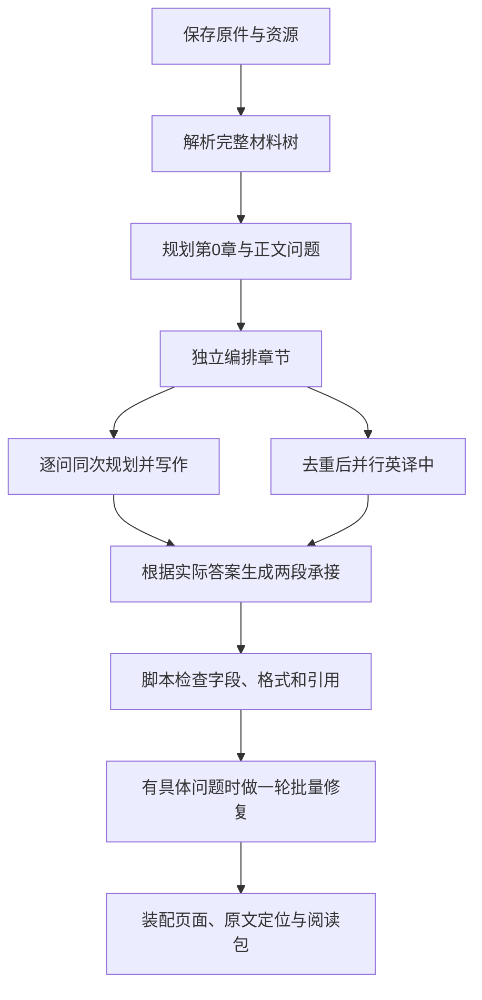

<div align="center">
<h1 align="center">LessonWeave · 课织</h1>
<p><strong>把网页、PDF 和代码，变成有来源映射的中文学习读本</strong></p>
<p>个人自托管 · 轻量 C 工作流 · AGPL-3.0</p>
<p><a href="README.en.md">English</a> · <a href="#2-怎样一键启动">一键启动</a> · <a href="framework/05_writing/lean-flow.md">核心工作流</a> · <a href="docs/deployment.md">VPS 部署</a></p>
</div>

<div align="center">

<p><sub>图 1.1　真实阅读工作台，截图使用自编演示材料</sub></p>
</div>

## 1 这个工作流怎样帮助读者理解材料

用户提交网页、一份 PDF 或一个项目 ZIP 后，LessonWeave 保存原件，解析材料树，规划问题与章节，再逐问生成讲解、独立媒体讲解、练习和术语，读者可以回到原句、原页或源码位置，并保存自己的笔记

每个问题在同一次模型调用中先列多条讲解规划，再围绕它们写出多组讲解，这就是 C 流程；末尾由脚本检查字段、格式与来源引用，有具体问题时只做一轮批量修复，正文语义质量的 AI 审查保持关闭

## 2 怎样一键启动

准备 Python 3.11+、Node.js 20+ 和可用的 Codex CLI 登录；网页归档还需要 Docker，英译中需要把官方 DeepSeek 密钥设置到环境变量 AIALRA_DEEPSEEK_OFFICIAL_KEY

```bash
# 下载源码并启动跨平台安装器
 git clone https://github.com/AIALRA-0/AIALRA-LessonWeave.git
 cd AIALRA-LessonWeave
 python deploy/bootstrap.py
```

这个 Python 入口支持 Windows、Linux 和 macOS，安装器会安装依赖并启动网站

打开 http://127.0.0.1:8960/workspace

首次登录由 codex login 处理，默认数据保存在用户目录的 .lessonweave 中

Ubuntu 或 Debian VPS 在仓库内执行下面命令

```bash
# 安装系统服务，随后按部署指南接入已有认证反向代理
sudo bash deploy/install-vps.sh
```

网站会使用执行账户的模型额度，密钥和登录信息放在仓库外；VPS 的登录、翻译凭据、所有者和域名配置见[部署指南](docs/deployment.md)

## 3 从提交到阅读会经历哪些步骤

<div align="center">



<p><sub>图 3.1　正文与翻译并行，术语随正文生成，页面与原文定位由脚本处理</sub></p>
</div>

工作台在同一页的左侧垂直列出阶段，右侧显示完成数、活动调用、等待情况、耗时和已保存记录，刷新或重新打开后继续读取后台任务

默认使用 Sol high 规划与写作，正文并发 144；Flash 非推理英译中并发 12；承接每批 16 节、并发 7；修复并发 3

已有词义复用完整定义、生活类比和简短通用实例，特殊词义单独保存；配置与职责见[轻量 C 流程](framework/05_writing/lean-flow.md)

## 4 核心 harness 在哪里

- lessonweave/planning.py 调度问题与独立章节规划，首轮包含第 0 章，脚本只补实际缺项
- lessonweave/lean.py 调度逐问写作、翻译、承接与装配
- framework/00_source 到 framework/05_writing 保存解析器、Schema、提示词和检查器
- framework/reader 与 web 保存阅读器、任务进度和系统信息
- deploy 保存本地与 VPS 安装入口，tests 保存不消耗模型额度的回归检查

运行材料、模型日志、账号、笔记、实验归档和机器配置不进入公开仓库

## 5 怎样验证与维护

```bash
# 安装测试依赖并检查核心行为
python -m pip install -e '.[test]'
python -m pytest
```

覆盖率按材料的实际去向和讲解来源引用计算，原文定位另外记录精确、歧义与未定位状态；PDF 公式保留原图，第三方视频的离线回放仍可能有缺口

生成结果可导出为阅读包，也可通过[ReadWeave 适配器](integrations/readweave/HANDOFF.md)接入 Trilium，部署前应备份持久目录和数据库

问题请使用自编材料在本仓库 Issues 复现，移除私人原文和调用日志；安全报告见 [SECURITY.md](SECURITY.md)，许可证见 [LICENSE](LICENSE)，第三方署名见 [NOTICE](NOTICE)

